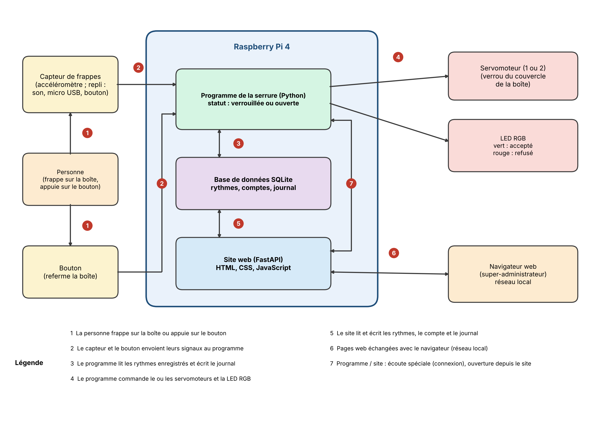
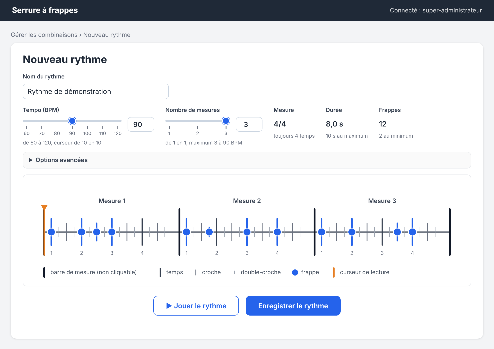
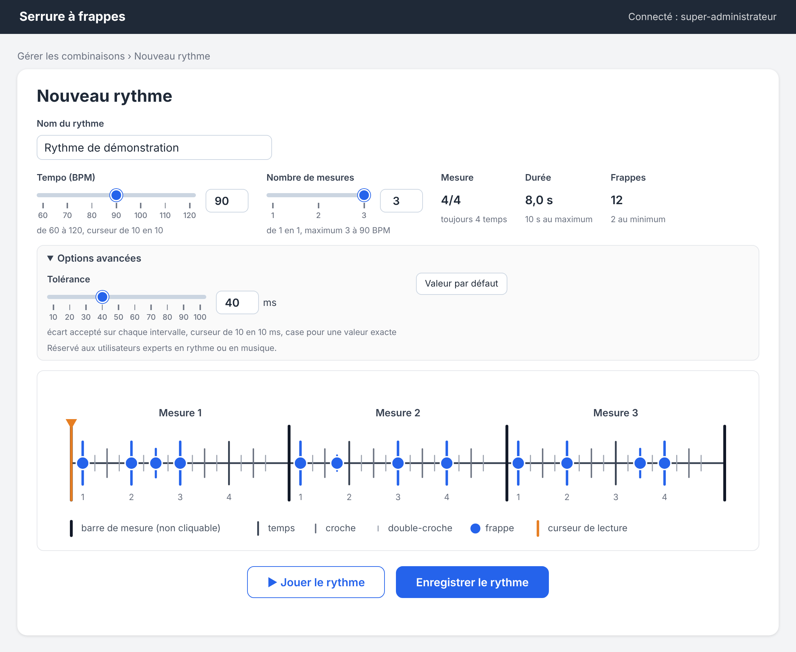
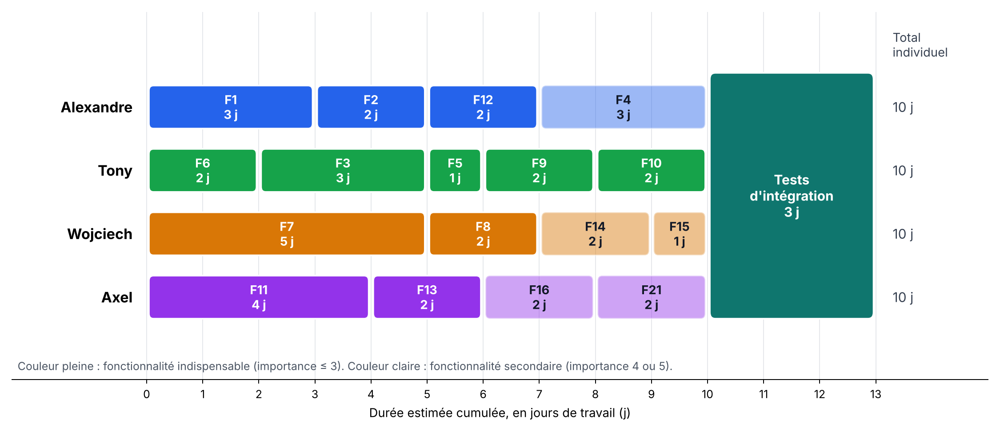

# Serrure à frappes

## 1. Introduction

Ce projet est une **serrure à frappes** : une boîte dont le couvercle ne s'ouvre que si l'on frappe dessus un rythme enregistré à l'avance. Un capteur détecte les frappes. Un Raspberry Pi mesure les intervalles de temps entre les frappes, puis les compare à ceux des rythmes enregistrés, avec une marge de tolérance par défaut ou indiquée par l'utilisateur. Si le rythme correspond, la LED RGB s'allume en vert et un servomoteur déverrouille le couvercle (voir « Version minimale » si la boîte n'est pas réalisable). Sinon, la boîte reste verrouillée. Chaque tentative, réussie ou non, est enregistrée dans une base de données. Un site web permet à un administrateur et au super-administrateur de créer, modifier et supprimer les rythmes avec une page interactive inspirée de la notation musicale, et de consulter le journal des tentatives.

**Deux versions.** La première version ne comporte qu'un seul compte, celui du super-administrateur. Une version ultérieure ouvrira la création de comptes : chaque utilisateur gérera alors ses propres rythmes (fonctionnalités 17 à 19 de la section 4). Le site et ses options ne seraient pas les mêmes dans les deux versions. Selon l'avancement du projet et les difficultés rencontrées, seule la première version sera peut-être terminée pour la démonstration.

**Nature du projet.** Le projet répond à un besoin pratique simple, contrôler l'accès à un objet, avec un objectif ludique. C'est un **démonstrateur** : il n'a pas la prétention d'être un moyen de verrouillage fiable. Un rythme peut se deviner en écoutant, et nous ne cherchons pas à l'empêcher. La boîte est une boîte de démonstration, sans usage réel.

**But.** Le projet est réussi si, lors de la démonstration :

1. le super-administrateur (ou un administrateur classique si la version ultérieure est réalisée) peut ajouter et supprimer des rythmes depuis la page interactive du site ;
2. frapper un rythme enregistré déverrouille la boîte (ou, en version minimale, allume la LED RGB en vert) ;
3. une mauvaise combinaison laisse la boîte verrouillée ;
4. le super-administrateur peut consulter dans le journal du site les tentatives, réussies ou refusées.

**Réalisation de la boîte.** Si nous avons une imprimante 3D à notre disposition, nous fabriquons la boîte nous-mêmes, avec l'aide de l'IA pour sa conception. Sinon, nous essayons de la fabriquer avec nos propres moyens. Si le temps nous manque ou si cela s'avère trop compliqué, nous prenons une boîte existante que nous essayons d'adapter. Si tout cela est trop compliqué, nous restons sur une table de test, avec seulement la LED RGB (voir « Version minimale »).

**Version minimale.** Si l'installation du ou des servomoteurs dans la boîte est trop compliquée ou impossible avec le matériel et le temps à notre disposition, la boîte et les servomoteurs ne sont plus indispensables. Le projet est alors réussi si les frappes d'un rythme valide mettent au moins la LED RGB en vert, les autres critères restant inchangés. Un seul servomoteur peut ne pas suffire pour la boîte qui sera utilisée : dans ce cas, nous en utiliserons deux. Ce point sera vérifié pendant les tests.

**Ce que le projet ne fait pas.**

- Pas de sécurité réelle : aucune protection contre un rythme deviné ou observé. Les rythmes sont stockés tels quels dans la base, car la comparaison exige une tolérance. Les échanges avec le site ne sont pas chiffrés (HTTP, réseau local). Seuls les mots de passe sont protégés (voir la section 2).
- Pas d'application mobile : seulement un site web.
- Pas d'accès depuis l'Internet public : le site n'est accessible que depuis le réseau local, y compris pour la démonstration. Tailscale est seulement un outil de travail du groupe pour développer à distance, il ne fait pas partie du produit.
- Nombre limité de rythmes et de personnes qui l'utilisent : plus il y a de rythmes enregistrés, plus la boîte risque de s'ouvrir pour tout et pour rien, donc moins la serrure est sécurisée. C'est une raison de plus, en plus des autres, de ne pas prétendre à la sécurité.

**Précisions de fonctionnement.**

- Un rythme est défini par un nom, un nombre de BPM (Battements Par Minute, ou Beats Per Minute), un nombre de mesures (sections d'un rythme, comme en musique) et le placement des frappes dans ces mesures : sur un temps (1er, 2e, 3e ou 4e), sur une croche (la moitié d'un temps) ou sur une double-croche (le quart d'un temps). Le nom est choisi par l'utilisateur et sert à retrouver le rythme dans la liste et dans le journal. Toutes les mesures sont à 4 temps (4/4). La tolérance peut aussi être précisée par l'utilisateur dans un menu « Options avancées ».
- Le BPM est compris entre 60 et 120. La durée du rythme ne doit pas dépasser 10 secondes : durée = nombre de mesures × 4 × 60 / BPM ≤ 10 s. La durée compte les mesures entières, silence final compris. Le nombre de mesures est d'au moins 1, et son maximum est la partie entière de BPM / 24. Exemples :

| BPM | Durée d'une mesure | Mesures maximum | Durée au maximum |
| --- | --- | --- | --- |
| 60 | 4,00 s | 2 | 8,0 s |
| 71 | 3,38 s | 2 | 6,8 s |
| 72 | 3,33 s | 3 | 10,0 s |
| 95 | 2,53 s | 3 | 7,6 s |
| 96 | 2,50 s | 4 | 10,0 s |
| 119 | 2,02 s | 4 | 8,1 s |
| 120 | 2,00 s | 5 | 10,0 s |

&nbsp;&nbsp;&nbsp;&nbsp;À 72, 96 et 120 BPM, le maximum atteint exactement 10 s, ce qui est autorisé. Si l'utilisateur baisse le BPM, le site ramène le nombre de mesures au maximum autorisé.

- Un rythme contient au moins 2 frappes : avec une seule frappe, il n'y aurait aucun intervalle à comparer. Le site refuse d'enregistrer un rythme qui en contient moins. Cette règle vaut aussi pour la combinaison de connexion.
- Il peut y avoir un nombre quelconque de rythmes enregistrés. Un seul suffit pour la démonstration ; un second est facultatif, il permet de montrer que la boîte distingue deux rythmes. Dans la version ultérieure, chaque rythme appartient à la personne qui l'a créé.
- La **tolérance par défaut** sera fixée pendant les tests, pour un utilisateur qui connaît son rythme mais qui n'est pas un spécialiste (ni musicien, ni rythmicien) : assez stricte pour rester sélective, assez large pour qu'il puisse refaire son rythme sans se tromper. La tolérance s'exprime en millisecondes : c'est l'écart accepté entre chaque intervalle frappé et l'intervalle théorique du rythme (calculé à partir du BPM et du placement des frappes). L'option avancée de réglage de la tolérance est réservée aux utilisateurs experts en rythme ou en musique, pour augmenter la sécurité de leur rythme. Elle se règle avec un curseur de 10 en 10 ms (de 10 à 100 ms) et une case de saisie pour une valeur exacte. Un bouton remet la valeur par défaut.
- Les tentatives sont illimitées.
- Le journal contient, pour chaque ligne : la date et l'heure, le type d'événement (tentative sur la boîte, connexion au site, ouverture depuis le site, refermeture avec le bouton), le résultat (accepté ou refusé) et, pour une tentative acceptée, le nom du rythme reconnu.

---

## 2. Schéma général du projet

Le dispositif est composé de :

- un **capteur de frappes** : l'accéléromètre (disponible), avec en repli le capteur de son, le micro USB ou le bouton, à confirmer selon la simplicité d'implémentation et la qualité des enregistrements ;
- une **boîte**, dont le couvercle est verrouillé par le ou les servomoteurs (sa réalisation est décrite dans la section 1) ;
- un **bouton** placé sur la boîte, qui referme la boîte quand elle est ouverte ;
- un **Raspberry Pi 4** qui lit le capteur et le bouton, compare les rythmes, garde en mémoire le statut de la boîte (verrouillée ou ouverte), héberge la base de données et le site ;
- un **servomoteur**, ou deux si un seul ne suffit pas pour la boîte retenue (à vérifier pendant les tests), qui verrouille et déverrouille le couvercle ; il n'est pas indispensable dans la version minimale ;
- une **LED RGB** pour le retour visuel (vert : accepté, rouge : refusé) ;
- une **base de données SQLite** (rythmes, comptes, journal) ;
- un **site web** (Python avec FastAPI, HTML, CSS, JavaScript), utilisé depuis un navigateur sur le réseau local. FastAPI nous a été conseillé par l'enseignante : il ressemble à Flask et permet en plus des opérations asynchrones, donc de lancer des calculs ou de récupérer des valeurs sur le Raspberry Pi en parallèle.

*Figure 1 : Schéma général du dispositif*

La figure 1 présente le dispositif. La personne frappe sur la boîte et le capteur transmet les frappes au programme de la serrure, qui tourne sur le Raspberry Pi. Le bouton envoie aussi son signal au programme. À chaque tentative, le programme consulte la base de données pour comparer le rythme frappé aux rythmes enregistrés, puis y écrit la tentative. Il commande ensuite le ou les servomoteurs et la LED RGB. Le site lit et écrit dans la même base. Le programme et le site échangent aussi directement pour l'écoute spéciale (connexion par la combinaison) et pour l'ouverture depuis le site. Le super-administrateur utilise le site avec un navigateur, sur le réseau local.

**Statut de la boîte.** Le programme mémorise si la boîte est « verrouillée » ou « ouverte ». Quand elle est ouverte, un appui sur le bouton la referme et le statut repasse à « verrouillée ». Quand elle est verrouillée, le bouton ne referme rien : s'il sert aussi de capteur de frappes (solution de repli), un appui compte comme une frappe. Au démarrage, le statut est « verrouillée ».

**Mise en œuvre des quatre contraintes du projet :**

| Contrainte | Comment elle est remplie |
| --- | --- |
| Capteur et actionneur via un Raspberry Pi | Capteur de frappes et bouton en entrée, LED RGB et servomoteur(s) en sortie (le servomoteur n'est pas indispensable dans la version minimale) |
| Enregistrement des données dans une base | Les rythmes, le compte et le journal (date, type d'événement, résultat, rythme reconnu) sont stockés dans SQLite |
| Site web | Page interactive de création des rythmes, gestion des rythmes, journal, ouverture depuis le site |
| Interaction avec un humain | Frappes sur la boîte, ouverture du couvercle, bouton, retour par la LED RGB, actions sur le site |

**Où l'humain intervient ?** Sur la boîte, la personne frappe son rythme, et referme la boîte avec le bouton. Sur le site, le super-administrateur dessine et gère les rythmes, consulte le journal et peut ouvrir la boîte.

**Acteurs :**

- **Personne qui frappe** : elle connaît un rythme enregistré et peut déverrouiller la boîte avec. Elle n'a pas de compte et n'est pas identifiée.
- **Super-administrateur** : seul titulaire d'un compte dans la première version. Il gère tous les rythmes, consulte le journal et ouvre la boîte depuis le site. Il peut aussi déverrouiller la boîte en frappant un rythme.

Dans la version ultérieure, n'importe qui peut créer un compte avec un identifiant et un mot de passe. Chaque utilisateur est alors administrateur de ses propres rythmes, et seulement des siens, avec sa propre combinaison de connexion. Le super-administrateur peut modifier tous les rythmes et supprimer les comptes. Seul le super-administrateur voit le journal.

**Sécurité des comptes.** Les mots de passe ne sont jamais stockés en clair : la base de données garde seulement leur empreinte (un hachage), qui ne permet pas de retrouver le mot de passe si la base est lue. C'est la partie du projet que nous protégeons réellement. La serrure à frappes elle-même ne l'est pas (voir « Ce que le projet ne fait pas »).

---

## 3. Scénarios d'usage

**Scénario 1 : déverrouiller la boîte.** Une personne frappe sur la boîte un rythme enregistré. Le Raspberry Pi mesure les intervalles entre les frappes et les compare à ceux des rythmes enregistrés, avec la tolérance. Le rythme est valide : la LED RGB s'allume en vert, le servomoteur déverrouille le couvercle (si la boîte est installée), le statut de la boîte passe à « ouverte » et la tentative est enregistrée comme réussie.

**Scénario 2 : tentative refusée.** Une personne frappe un rythme inconnu. La boîte reste verrouillée, la LED RGB s'allume en rouge, et la tentative est enregistrée comme refusée. Les tentatives sont illimitées.

**Scénario 3 : reverrouiller la boîte.** Quand la boîte est ouverte, un appui sur le bouton placé sur la boîte referme le verrou (si la boîte est installée), et le statut repasse à « verrouillée ».

**Scénario 4 : premier lancement.** Au tout premier lancement, aucun compte n'existe. Le site affiche une page de configuration qui demande le mot de passe du super-administrateur. Une fois le compte créé, le site ouvre directement la page de création de la combinaison administrateur (la même page que pour les rythmes, voir le scénario 6) : la combinaison est ainsi enregistrée dès la création du compte. La page de configuration n'est plus accessible dès que le compte existe. Le mot de passe est stocké sous forme de hachage. La base de données est créée automatiquement à partir d'un fichier de schéma (les tables, sans aucune donnée) qui est dans le dépôt GitHub. Le fichier de la base lui-même n'est jamais dans le dépôt, pour ne pas y mettre le compte, les rythmes et le journal.

**Scénario 5 : se connecter pour gérer les combinaisons.** Le super-administrateur ouvre le site et clique sur « Gérer les combinaisons ». Le site affiche « Taper la combinaison administrateur ». La boîte passe alors en écoute spéciale : elle n'essaie plus de déverrouiller, elle transmet seulement au site si la combinaison administrateur est reconnue. Si oui, le site ouvre la gestion des rythmes. En dessous, un petit bouton « Taper le mot de passe administrateur » affiche un champ de texte et un bouton de validation. Il sert de secours si la combinaison ne fonctionne pas. Si quelqu'un frappe la combinaison administrateur sans avoir cliqué sur le site, la tentative est refusée comme un rythme inconnu : la combinaison ne sert qu'à se connecter. Elle peut être identique à un rythme de déverrouillage, car les deux usages sont séparés.

**Scénario 6 : créer un rythme.** Le super-administrateur connecté ouvre la page interactive de création d'un rythme. Elle ressemble à une partition simplifiée, sans notes :

- un champ pour le nom du rythme (absent pour la combinaison administrateur) ;
- une seule ligne horizontale ;
- des traits verticaux : les barres de mesure (les plus grands, non cliquables), puis les temps (4 par mesure), les croches (8 par mesure) et les doubles-croches (16 par mesure), de plus en plus petits ;
- un curseur de lecture, trait de couleur placé au début de la première mesure, qui se déplace le long de la ligne quand on joue le rythme ;
- le BPM (de 60 à 120) et le nombre de mesures (1 au minimum, au maximum selon le BPM), réglés chacun par un curseur à graduations sur lesquelles il se place (de 10 en 10 pour le BPM, de 1 en 1 pour les mesures) et par une case où l'on saisit la valeur exacte ; toutes les mesures sont à 4/4 ;
- l'affichage de la durée totale du rythme (10 s au maximum) et du nombre de frappes placées (2 au minimum pour enregistrer) ;
- un menu « Options avancées », replié par défaut, qui permet de changer la tolérance avec un curseur gradué de 10 en 10 ms et une case en millisecondes, avec un petit bouton pour remettre la valeur par défaut ;
- en bas, deux boutons : « Jouer le rythme » et « Enregistrer le rythme ».

Une frappe se place en cliquant sur un temps, une croche ou une double-croche, jamais sur une barre de mesure. Le premier temps de chaque mesure est placé juste après la barre de mesure, pour rester cliquable.

*Figure 2 : Aperçu de la page de création d'un nouveau rythme (généré par IA)*

*Figure 3 : Aperçu de la page de création d'un nouveau rythme avec le menu « Options avancées » (généré par IA)*

[maquette_rythme.html](images/maquette_rythme.html)

*Figure 4 : Aperçu interactif de la page de création d'un nouveau rythme (généré par IA). Fichier HTML à télécharger puis à ouvrir dans un navigateur : GitHub n'exécute pas ce type de fichier.*

**Scénario 7 : jouer le rythme.** Le super-administrateur clique sur « Jouer le rythme » pour entendre ce qu'il a dessiné. Le site joue le rythme avec le son du navigateur, au BPM choisi, et le curseur de lecture se déplace sur la ligne au même moment.

**Scénario 8 : enregistrer le rythme.** Le super-administrateur clique sur « Enregistrer le rythme ». Si le rythme contient moins de 2 frappes, le site refuse de l'enregistrer et l'indique. Si un rythme identique ou trop proche existe déjà (même nombre de frappes et chaque intervalle dans la tolérance), le site l'indique et demande d'en faire un autre. Sinon, le rythme est sauvegardé en base.

**Scénario 9 : modifier ou supprimer un rythme.** Le super-administrateur voit la liste des rythmes enregistrés, avec leur nom. Il peut en modifier ou en supprimer.

**Scénario 10 : consulter le journal.** Le super-administrateur consulte sur le site la liste des événements : date et heure, type d'événement, résultat et, pour une tentative acceptée, nom du rythme reconnu.

**Scénario 11 : ouvrir depuis le site.** Le super-administrateur clique sur un bouton du site et la boîte se déverrouille (si la boîte est installée, sinon la LED RGB s'allume en vert). Lui seul peut le faire.

**Scénario 12 : modifier son mot de passe ou sa combinaison de connexion.** Le super-administrateur connecté ouvre la page de son compte. Il peut y changer son mot de passe (le nouveau mot de passe est stocké sous forme de hachage) ou refaire sa combinaison de connexion avec la même page que pour les rythmes (scénario 6). Cette possibilité est prévue vers la fin du projet. Dans la version ultérieure, chaque utilisateur peut le faire pour son propre compte.

**Scénarios de la version ultérieure.**

**Scénario 13 : créer un compte.** N'importe qui clique sur « Créer son compte » et choisit un identifiant et un mot de passe. Le site ouvre ensuite directement la page de création de sa combinaison de connexion, comme pour le super-administrateur au scénario 4.

**Scénario 14 : se connecter avec son compte.** L'utilisateur saisit son identifiant sur le site, puis tape sa combinaison personnelle sur la boîte en écoute spéciale. Le mot de passe écrit reste possible en secours. Il gère ensuite uniquement ses rythmes.

**Scénario 15 : supprimer un compte.** Le super-administrateur supprime un compte. Les rythmes de ce compte sont supprimés avec lui.

---

## 4. Description des fonctionnalités

Rappel : une importance inférieure ou égale à 3 est indispensable, au-delà c'est secondaire.

| n° | Nom | Description | Sur quoi la fonction agit | Importance |
| --- | --- | --- | --- | --- |
| 1 | Détecter les frappes | Le Raspberry Pi lit le capteur (accéléromètre, en repli capteur de son, micro USB ou bouton) et repère chaque frappe | Capteur, Raspberry Pi | 1 |
| 2 | Mesurer le rythme | Le Raspberry Pi calcule les intervalles de temps entre les frappes | Raspberry Pi | 1 |
| 3 | Comparer le rythme | Le Raspberry Pi compare les intervalles mesurés à ceux des rythmes enregistrés, avec la tolérance | Raspberry Pi, base de données | 1 |
| 4 | Commander le verrou | Le Raspberry Pi déverrouille le couvercle si le rythme est valide, avec un ou deux servomoteurs. Dans la version minimale, cette fonction n'est pas nécessaire : la LED RGB verte suffit | Raspberry Pi, servomoteur(s) | 4 |
| 5 | Signaler le résultat | La LED RGB s'allume en vert si le rythme est accepté, en rouge s'il est refusé | Raspberry Pi, LED RGB | 2 |
| 6 | Enregistrer le journal | Chaque événement est enregistré avec la date et l'heure, son type (tentative sur la boîte, connexion, ouverture depuis le site, refermeture), son résultat et, si la tentative est acceptée, le nom du rythme reconnu | Raspberry Pi, base de données | 2 |
| 7 | Créer un rythme | Le super-administrateur dessine un rythme sur la page interactive (nom, BPM, mesures, 2 frappes au minimum) et l'enregistre | Site, base de données | 2 |
| 8 | Modifier ou supprimer un rythme | Le super-administrateur modifie ou supprime un rythme enregistré | Site, base de données | 2 |
| 9 | Refuser un rythme trop proche | Le site refuse un rythme identique ou trop proche d'un rythme existant (même nombre de frappes, chaque intervalle dans la tolérance) et demande d'en faire un autre | Site, base de données | 3 |
| 10 | Créer le compte super-administrateur | Au premier lancement, le site demande le mot de passe du super-administrateur, stocké sous forme de hachage, puis ouvre la page de création de sa combinaison de connexion | Site, base de données | 3 |
| 11 | Se connecter | Le super-administrateur se connecte par sa combinaison frappée sur la boîte (écoute spéciale) ou par son mot de passe | Site, Raspberry Pi, capteur, base de données | 3 |
| 12 | Gérer le statut de la boîte | Le programme mémorise si la boîte est verrouillée ou ouverte. Un appui sur le bouton referme la boîte ouverte | Raspberry Pi, bouton, servomoteur(s) | 3 |
| 13 | Consulter le journal | Le super-administrateur affiche le journal sur le site | Site, base de données | 3 |
| 14 | Jouer le rythme | Le site joue le rythme dessiné avec le son du navigateur, et le curseur de lecture se déplace sur la ligne | Site | 4 |
| 15 | Régler la tolérance | Dans « Options avancées », l'utilisateur change la tolérance d'un rythme (en ms, curseur gradué de 10 en 10 et case de saisie). Un bouton remet la valeur par défaut | Site, base de données | 4 |
| 16 | Ouvrir depuis le site | Le super-administrateur déverrouille la boîte avec un bouton du site | Site, Raspberry Pi, servomoteur(s) | 4 |
| 17 | Créer un compte | N'importe qui crée un compte (identifiant et mot de passe) avec un bouton du site, puis crée sa combinaison de connexion. Version ultérieure | Site, base de données | 5 |
| 18 | Gérer ses propres rythmes | Chaque utilisateur crée, modifie et supprime seulement ses rythmes, et a sa propre combinaison de connexion. Version ultérieure | Site, Raspberry Pi, capteur, base de données | 5 |
| 19 | Supprimer un compte | Le super-administrateur supprime un compte, et ses rythmes avec. Version ultérieure | Site, base de données | 5 |
| 20 | Retour sonore | Le buzzer double le signal de la LED RGB | Raspberry Pi, buzzer | 5 |
| 21 | Modifier son mot de passe et sa combinaison | Le super-administrateur change son mot de passe écrit et refait sa combinaison de connexion. Prévu vers la fin du projet. Dans la version ultérieure, chaque utilisateur peut le faire pour son compte | Site, base de données | 5 |

---

## 5. Planning prévisionnel

Les fonctionnalités de la première version (F1 à F16, plus F21 en fin de projet) sont réparties équitablement entre les quatre membres du groupe, pour environ 10 jours de travail chacun. Chaque personne a sa propre piste, ce qui permet de travailler en parallèle :

- Alexandre : capteurs et actionneurs (capteur de frappes, mesure des intervalles, statut de la boîte, servomoteur(s)) ;
- Tony : logique de la serrure, LED RGB et base de données (journal, comparaison, signal de la LED, refus des rythmes proches, compte super-administrateur) ;
- Wojciech : site web (page interactive des rythmes, gestion des rythmes, lecture, tolérance) ;
- Axel : connexion et ouvertures (connexion par combinaison, consultation du journal, ouverture depuis le site, changement du mot de passe et de la combinaison).

Pour chaque membre, les fonctionnalités indispensables sont placées avant les fonctionnalités secondaires. La durée est une estimation du temps de travail, en jours de travail (j). Elle pourra changer pendant le projet. Les fonctionnalités 17 à 20 ne sont pas planifiées : elles ne seront traitées que si la première version est terminée. Une phase de tests d'intégration de 3 jours, faite par tout le groupe, suit le travail individuel. La figure 5 présente ce planning.

| Membre | Fonctionnalité (n°) | Durée estimée |
| --- | --- | --- |
| Alexandre | 1 | 3 j |
| Alexandre | 2 | 2 j |
| Alexandre | 12 | 2 j |
| Alexandre | 4 | 3 j |
| Tony | 6 | 2 j |
| Tony | 3 | 3 j |
| Tony | 5 | 1 j |
| Tony | 9 | 2 j |
| Tony | 10 | 2 j |
| Wojciech | 7 | 5 j |
| Wojciech | 8 | 2 j |
| Wojciech | 14 | 2 j |
| Wojciech | 15 | 1 j |
| Axel | 11 | 4 j |
| Axel | 13 | 2 j |
| Axel | 16 | 2 j |
| Axel | 21 | 2 j |
| Tout le groupe | Tests d'intégration | 3 j |

*Figure 5 : Planning prévisionnel (généré par IA)*
